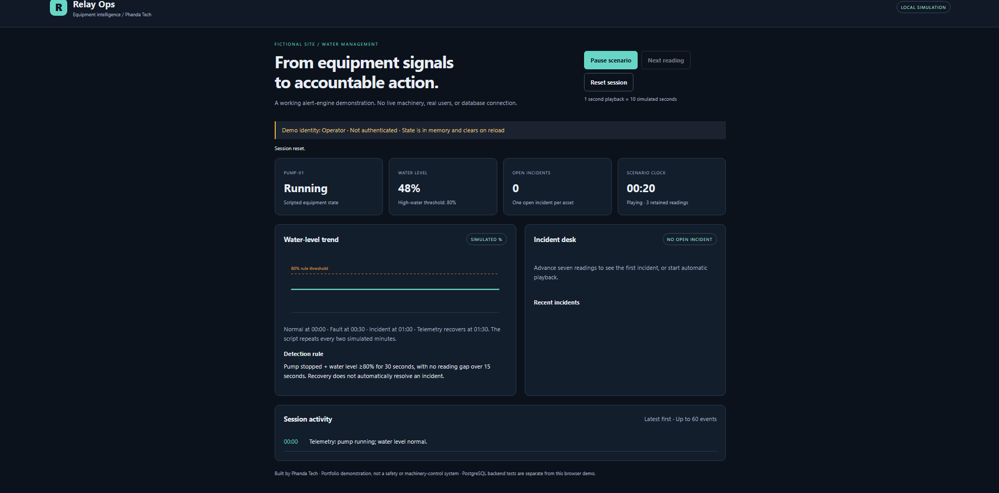
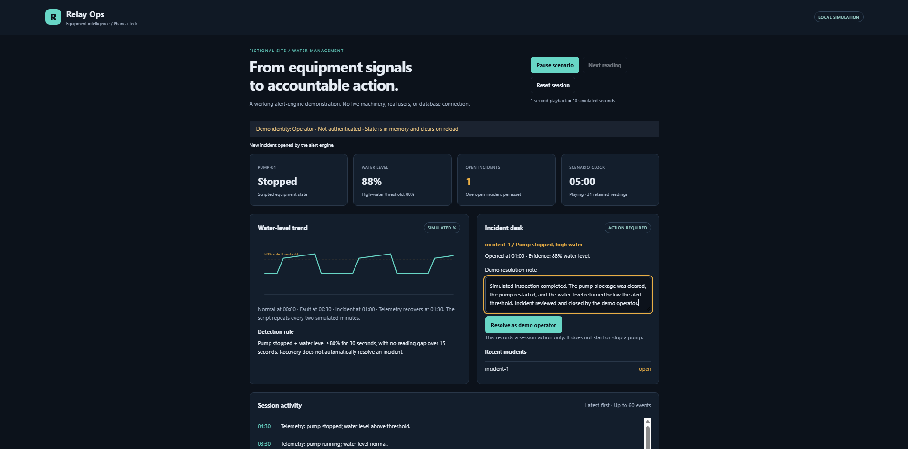
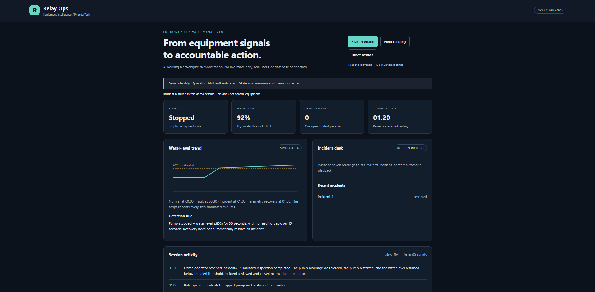

# Relay Ops

Equipment monitoring and incident management demonstration by Phanda Tech.

## Purpose

A fictional pump-and-water-level scenario demonstrates how equipment readings can become an actionable incident with recorded supporting evidence. This is a GitHub portfolio project, not a deployed industrial product or certified safety system.

## Dashboard screenshots

The project owner supplied and manually reviewed these screenshots of the fictional in-memory browser showcase, not a connected PostgreSQL workflow. On 27 October 2026, the owner confirmed normal operation, an open incident, resolved status, readable resolution-note/activity evidence, and no unwanted personal or private details. Independent visual inspection was not performed.

### Normal operation



### Open incident



### Resolved incident



## Try the local visual demo

Use Node.js 22.12 or newer within the Node.js 22 line. The reported local verification used Node.js 22.14.0 and npm 10.9.2. From the repository root:

```sh
npm ci
npm run dev
```

Open the loopback address printed by Vite. No database, credentials, API keys, or environment variables are needed for the browser demo. Nothing is hosted publicly by these commands.

1. Click Start scenario, or advance manually with Next reading.
2. Each reading advances the fictional clock by ten seconds.
3. At 00:30 the pump stops and water exceeds the threshold.
4. At 01:00 sustained abnormal readings open an incident.
5. Enter a fictional resolution note and resolve it as the demo operator.
6. Inspect the session activity and incident list. Pause/reset to repeat.

The script recovers telemetry at 01:30 and repeats every two simulated minutes. Resolving does not control machinery or alter the script; continued abnormal readings can open another incident after a full rule duration.

## Two explicit execution paths

### Browser showcase

React dashboard → deterministic fictional readings → existing TypeScript AlertEngine → in-memory incidents and session activity.

Demo identity is visibly labelled and is not authentication. Reloading clears all state. The trend retains 36 readings, the incident list retains 30 incidents, and activity retains 60 events; internal engine event-ID tracking remains unbounded during a session.

### Separately tested PostgreSQL backend

StoredPermissionTelemetry → guarded PostgreSQL functions → readings, rule state, memberships, equipment scopes, assignments, incidents, and activity.

Database migrations, transactional duplicate handling, permission checks, and restricted-login integration tests are included. The browser does NOT call this backend. Verified identities, API routes, read endpoints, and a connected full-stack UI are unfinished. Do not represent the visual demo as proof of a connected database workflow.

## Checks

```sh
npm run build:demo
npm test
npm audit
```

The demo build type-checks the project and bundles the interface into dist/demo. Integration tests require RELAY_TEST_DATABASE_URL and skip without it; dedicated CI requires that setting. Existing database workflows use disposable PostgreSQL services. See docs/adapter.md, docs/runtime-access.md, and docs/restricted-login-tests.md. Never use customer or production databases for these tests.

### Dependency and clean-install verification — 27 October 2026

Vitest is pinned to 5.0.5 and package-lock.json is committed. Owner-supplied terminal output confirms a successful npm ci, TypeScript check, Vite 6.4.5 dashboard build, 27 passing regular tests with 12 database tests skipped locally, and an npm audit result of 0 vulnerabilities. This verifies the reported Windows environment, not every platform.

The owner separately reported that the dedicated CI integration job passed all 12 database tests, and that Database persistence checks and Stored permission checks were green after the dependency upgrade. These account for 39 Vitest tests across the regular and integration jobs plus separate SQL checks; workflow-run reports were not independently retrieved. Three scenario tests cover deterministic readings, scenario stages, and first incident timing. A clean audit is a point-in-time advisory result, not a vulnerability-free guarantee.

The lockfile inventory contains 135 non-root entries: 129 MIT, 2 Apache-2.0, 3 ISC, and 1 BSD-3-Clause, with no missing declarations. Actual license texts were inspected for React, React DOM, Scheduler, and the six non-MIT entries. Browser runtime notices are included in demo/public/THIRD-PARTY-NOTICES.txt; unchanged copying into the build was verified locally before a possible cosmetic heading edit. Full dependency-license compliance and bundle composition have not been independently established. See [the dependency-review record](docs/dependency-review.md).

### Desktop and screenshot verification — 27 October 2026

The owner reported successful simulation, incident creation and resolution with a fictional note, pause, manual stepping, reset, long resolution notes, keyboard navigation, and narrow desktop layout. The owner also reviewed all three screenshots and confirmed readable resolved-note/activity evidence and no unwanted private details.

These are owner-reported manual results. Exact browser, desktop operating system, viewport dimensions, and browser-test commit were not recorded. Independent screenshot inspection remains pending. A narrow desktop window alone is not a phone test; these checks are not a comprehensive accessibility audit. See [the browser-verification record](docs/browser-verification.md).

### Actual-device smoke test — 27 October 2026

The owner reported that the manual phone checklist passed on a Samsung S26 Ultra using Samsung Internet over a local-network Vite preview: portrait layout, simulation and incident creation, resolution with fictional note/activity evidence, pause, manual stepping, reset, and landscape rotation and return to portrait. This was not a public deployment.

Chrome on the same phone returned ERR_TOO_MANY_RETRIES; its cause remains undiagnosed and no passing Chrome retest was reported. Exact Android/browser versions, viewport dimensions, and tested commit were not recorded. This is owner-reported evidence for one device/browser, not independently executed testing, universal mobile compatibility, or a comprehensive accessibility audit. See [the detailed phone-test record](docs/browser-verification.md#actual-device-smoke-test--27-october-2026).

### Scoped privacy checks — 27 October 2026

Personal commit-email metadata was replaced with a GitHub noreply address. The rewritten baseline is 3b34a7713963c21dff6c0e0d787329ddfa351cc8. GitHub metadata retrieval returned 22 commits through the initial commit, with no personal email in author/committer fields. The owner reported zero matches for the old email across reachable tracked text history. The current tracked-file tree remained 5c117a4fd56f147796e107460eb103eb30be57b9 across the rewrite.

Owner-run historical filename screening found no matches for the tested sensitive-name patterns. Credential-keyword screening returned ten paths; inspected current matches were disposable CI credentials, generated test credentials, or documentation. This is not a review of every historical version.

The owner ran Gitleaks 8.30.1 using:

```sh
gitleaks git --redact=100 --no-banner --log-opts="--all" .
```

It reported 18 commits scanned, approximately 170.54 KB scanned, no leaks found, and exit code 0. Preserve that scanner-reported count separately from the 22 metadata records; full coverage of every commit has not been independently established. Scanner output was owner-supplied, not independently executed. These checks do not cover every private-information format, screenshots by automated analysis, unreachable objects, external caches, or old clones. Old-history backups must remain local and must not be pushed.

## Showcase completion checklist

- [x] Record owner-reported CI, desktop smoke tests, keyboard/narrow-layout checks, and long-note results.
- [x] Add the three dashboard screenshots and record the owner's visual/privacy review, including resolution-note/activity evidence.
- [x] Add the MIT license, dependency lockfile, and Vitest 5.0.5 pin.
- [x] Record successful owner-run clean installation, build, regular tests, and audit.
- [x] Preserve browser-runtime license notices and document the scoped dependency review.
- [x] Replace personal-email metadata in the reviewed main history and record scoped text-history and Gitleaks checks.
- [x] Record owner-reported actual-device smoke-test pass on Samsung S26 Ultra using Samsung Internet.
- [ ] Resolve or retest the reported Chrome access failure.
- [ ] Complete the broader dependency license-compliance review.
- [ ] Independently inspect screenshot contents.
- [ ] Resolve remaining privacy-review coverage limitations and separately approve any visibility change.

## License

[MIT](LICENSE), Copyright (c) 2026 Phanda Tech. Third-party dependencies retain their own licenses; the project license does not replace their terms.

## Scope and limitations

No live hardware, real client data, deployment, real operator authentication, or production-readiness claim. Thresholds are arbitrary demonstration values, not operational guidance. Session activity is editable/resettable demo memory, not a durable audit log. PostgreSQL activity protections have documented owner-level limitations.

Existing backend/security components remain engineering examples; production hardening is deferred in favour of finishing the bounded showcase. Historical slice documents in docs/ describe their state at the time, not necessarily the latest milestone. No visibility change, release, or deployment is authorized by these verification records.
